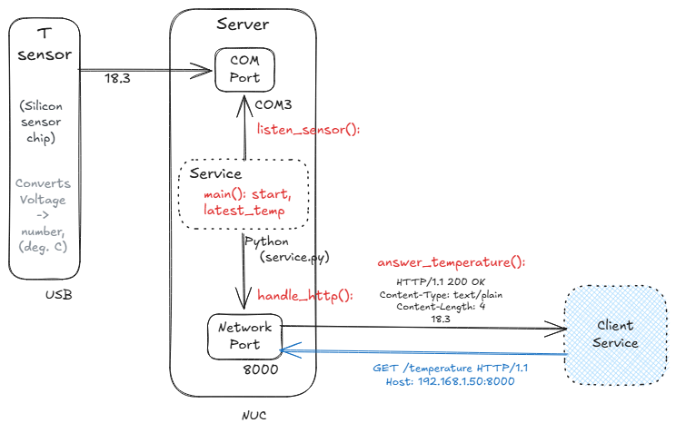

# Design

## What it does

The service reads a temperature sensor on a USB port and answers `GET /temperature` on port 8000 with the latest reading. Until a real sensor is attached, the reading is a stub: 18.3.

The design started as a NUC on a desk with a USB sensor. The deployed version runs on Railway with a simulated sensor. The architecture is the same; only the source of the reading changes.

## Physical requirements

- USB temperature sensor
- NUC (Windows Server)
- COM port (the USB sensor shows up as `COM3`)
- Network port (8000)
- A phone with a browser, as the client

## Software requirements

- Python 3.13: `asyncio` for the service, `pytest` for tests
- Later: FastAPI + uvicorn for HTTP, FastMCP for an MCP interface

## System diagram



## Repo layout

```
hi-t3c-mcp/
|-- README.md
|-- service.py              # the Service box: sensor loop + port 8000
|-- test_service.py         # pytest tests for service.py
|-- .gitignore
`-- docs/
    |-- design.md           # this file: what, why
    |-- design.PNG          # system diagram
    |-- interface-spec.md   # functions, state, HTTP in/out
    |-- scaffold-method.md  # diagram -> scaffold, any project
    |-- test-first-method.md
    |-- devlog.md           # working log
    |-- stack-notes-python.md
    `-- stack-notes-git.md
```

## Decisions

### 1. Read the sensor on a clock, not once per request

A cheap sensor can only be read every second or two. Requests can arrive much faster than that. Reading on a fixed schedule means no number of requests can overload the sensor.

Cost: the loop that reads the sensor and the function that answers requests never call each other, so the reading can't pass between them by argument or `return`. It sits in a module-level variable, `latest_temp`, that one writes and the other reads.

### 2. One thread, one event loop

The sensor loop and the HTTP handler share a single `asyncio` event loop. The loop waits with `await asyncio.sleep(2)`, which frees the thread so requests get answered during the wait. `time.sleep(2)` would freeze the whole program.

### 3. Hand-written HTTP first, FastAPI later

`handle_http()` reads the request bytes and writes the reply text itself, using `asyncio.start_server`. That makes what's on the wire visible in the code.

The switch to FastAPI is a planned refactor. From the outside, port 8000 answers the same way before and after. An HTTP-level test (send a real `GET`, check for `200` and the reading) covers both and should stay green through the switch. After the switch, `handle_http()` goes away and FastAPI calls `answer_temperature()` directly.

### 4. Rate limit at 5 requests per second

The endpoint is public, and bots scan the internet for open ports constantly. The limiter sits inside the service, between "request arrived" and "answer sent." Over the limit, the reply is `429 Too Many Requests`.

### 5. Host on Railway, not at home

A public port on a home network exposes the home IP address.

### 6. MCP as a second interface

FastMCP uses decorators the same way FastAPI does. The MCP tool can wrap the same functions the HTTP endpoint uses.

### 7. "Not ready" is a status code, not a value

Before the first reading, the reply is `503` with `Retry-After: 2`, never a `200` carrying a placeholder. If both came back as `200`, a client couldn't tell "not ready" from a real value.

### 8. Planned: each access code gets its own sequence

Readings currently change on a clock, so a client polling faster than the sensor period gets repeats, and can't tell a repeat from two equal readings in a row. With access codes, each allowed request gets the next reading for its code. Nothing repeats, and the end (`410`) is per code.

### 9. Planned: rate limit with a sliding window log

Each access code keeps the timestamps of its allowed requests. A request is allowed if fewer than 5 of those timestamps fall within the last second. Rejected requests don't count toward the five, and each 429 is logged per access code.

Considered: a token bucket (steady refill, allows short bursts). Not chosen, because the promise is "at most 5 in any 1-second window," and a sliding window log enforces that exactly.
[t-PLACEHOLDER] follow-up: build a token bucket with the same allow(t) shape and compare the edge case: a 6th request at 0.3 s (bucket: 200, window: 429).